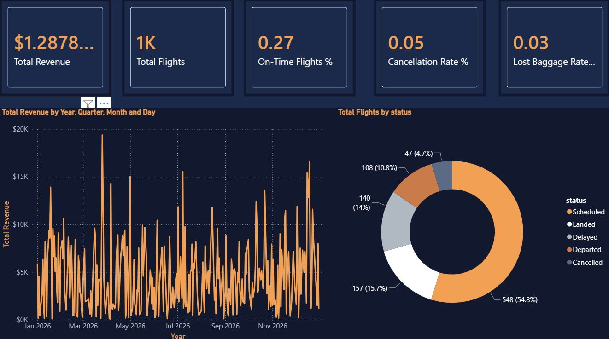
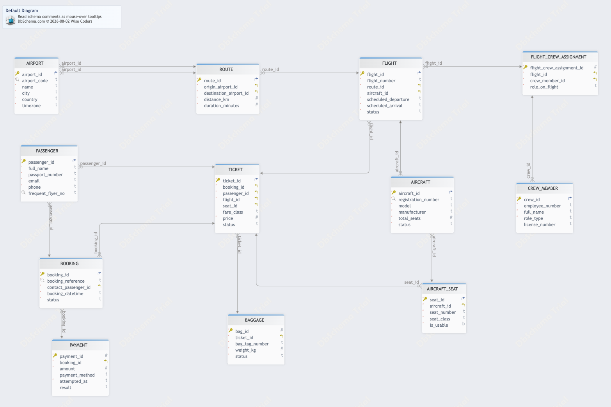
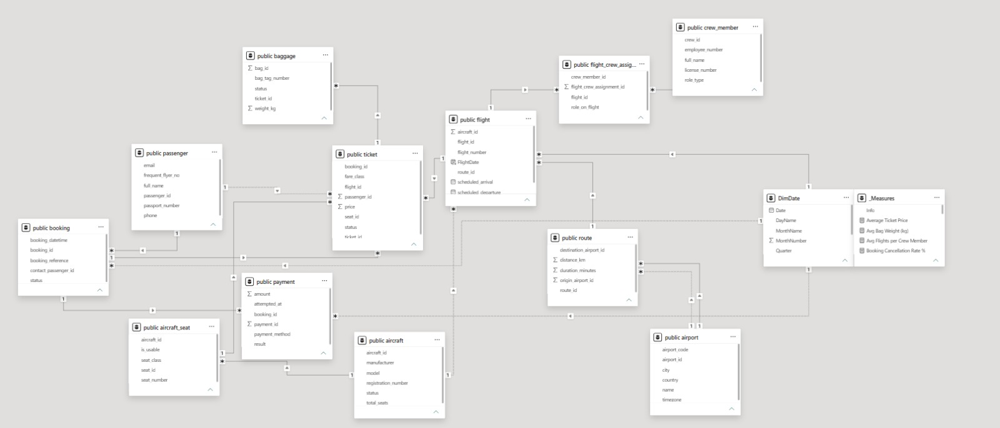
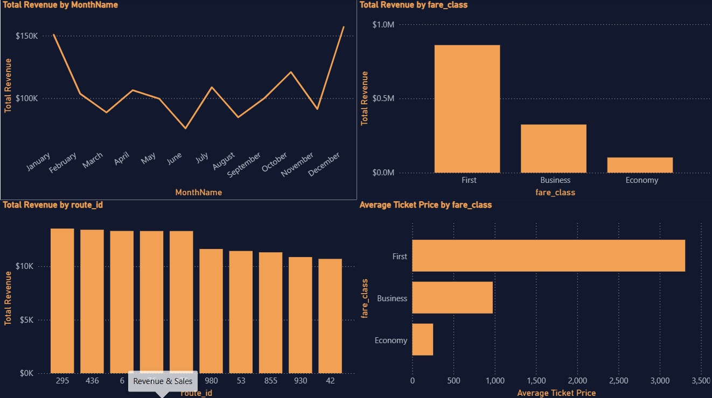
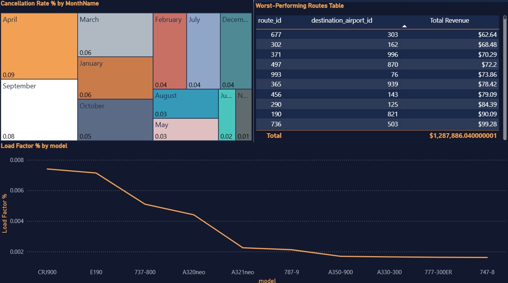
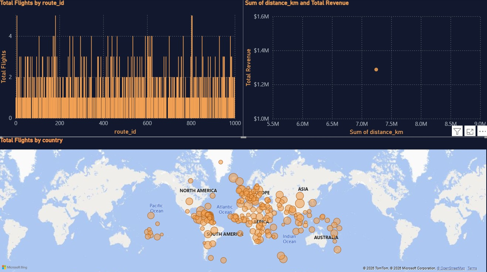
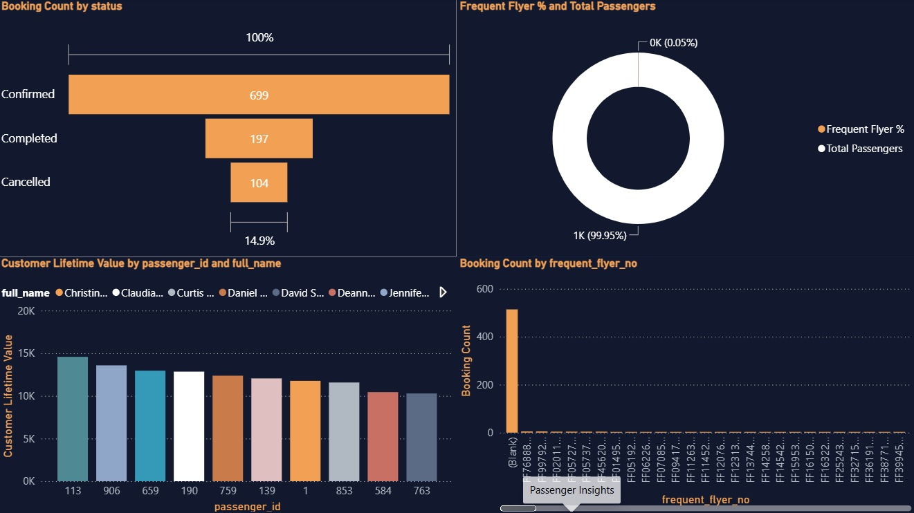
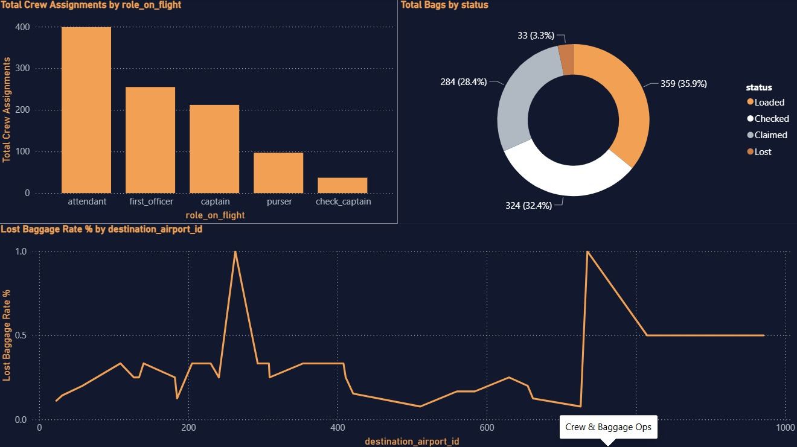

# ✈️ SkyLink Airlines Performance Analytics

An end-to-end data analytics project covering business requirements, relational database design, PostgreSQL development, SQL data analysis, and interactive Power BI dashboards for airline revenue, flight operations, route performance, passenger insights, crew utilization, and baggage handling.



---

## 📌 Project Overview

SkyLink is a fictional airline. The goal of this project is to answer one question a COO would ask:

> *"How is the airline actually performing, and where are we losing money or reputation?"*

I designed a 12-table PostgreSQL database, analysed it with SQL, and built a 6-page Power BI dashboard to turn the data into business insights.

## 🎯 Business Questions

- How much revenue do we earn, and which routes and fare classes drive it?
- What percentage of flights are on time, delayed or cancelled?
- Which routes are busiest and most profitable?
- Who are our most valuable passengers?
- How well are crew members utilised?
- How often are bags lost or payments failing?

## 🛠 Tools & Technologies

- **DbSchema**: data modeling, ER diagram and schema design
- **PostgreSQL**: database and SQL analysis
- **DbSchema**: ER diagram and schema design
- **Power BI Desktop**: data modelling, DAX and dashboards
- **Power Query**: data cleaning and transformation
- **Git & GitHub**: version control

## 🧱 Data Modeling

Before building the database, I designed the data model in **DbSchema**. This covered identifying the entities (flights, tickets, passengers, crew, etc.), defining primary and foreign keys, and setting the relationships between tables.



- DbSchema model file: [`datamodeling/data_modeling.dbs`](datamodeling/data_modeling.dbs)

## 🗄 Database Design

The data model was implemented in **PostgreSQL** as 12 normalized tables: `airport`, `route`, `aircraft`, `aircraft_seat`, `flight`, `passenger`, `booking`, `ticket`, `baggage`, `crew_member`, `flight_crew_assignment`, `payment`.

- Primary keys, foreign keys, and `CHECK` constraints keep the data valid
- Indexes on foreign keys speed up joins
- SQL script: [`database/sql_script.sql`](database/sql_script.sql)

## 🧩 Power BI Data Model

The database was reshaped into a star schema in Power BI, with a Date table.



## 📊 Dashboard

The report has 6 pages:

| Page | What it shows |
|---|---|
| Executive Overview | Key KPIs, revenue trend, flight status |
| Revenue & Sales | Revenue by month, fare class and route |
| Flight Operations | On-time, delay and cancellation rates, load factor |
| Route & Network | Map of routes, distance vs revenue |
| Passenger Insights | Frequent flyers, top customers, booking status |
| Crew & Baggage | Crew workload, baggage status, lost bags |

### Screenshots








- Power Bi file: [`powerbi/power_bi.pbix`](powerbi/power_bi.pbix)

## 💡 Key Insights

- **Revenue:** Total revenue of **$___** from **___** tickets.
- **Top fare class:** ______ generates **___%** of revenue.
- **Best route:** ______ is the highest-earning route.
- **Punctuality:** **___%** of flights were delayed and **___%** cancelled.
- **Baggage:** **___%** of bags were lost.
- **Payments:** **___%** payment success rate.

## 📁 Repository Structure

```
skylink-airlines-analytics/
├── README.md
├── datamodeling/  → data modeling, ER diagram and schema design
├── database/      → SQL scripts and datasets
├── powerbi/       → Power BI (.pbix) file
└── images/        → Screenshots and diagrams
```

## ▶️ How to Run

1. Clone the repository
   ```bash
   git clone https://github.com/<your-username>/skylink-airlines-analytics.git
   ```
2. Create a PostgreSQL database named `Skylink_Airline`.
3. Run the SQL script in `database/` to create the tables and load the data.
4. Open the `.pbix` file in `powerbi/` with Power BI Desktop.
5. Update the data source to your PostgreSQL server and click **Refresh**.

## 🧠 Skills Demonstrated

SQL · PostgreSQL · DbSchema · Database Design · Data Modelling · Power Query · DAX · Dashboard Design · Data Storytelling

## 👤 Author

**Muhammad Ali Raja**
[LinkedIn](www.linkedin.com/in/m-ali-raja) · mohammadali_raja20@outlook.com

> All data is synthetic and created for portfolio purposes. SkyLink Airlines is a fictional company.
